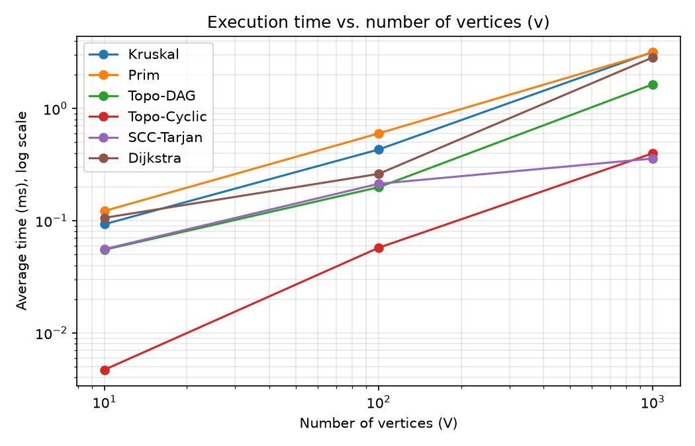
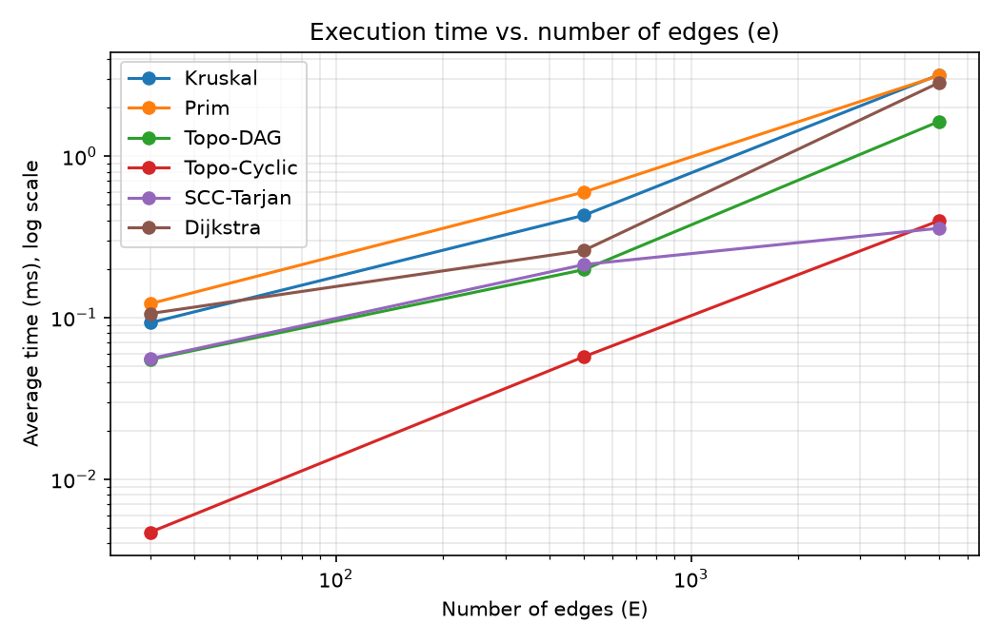
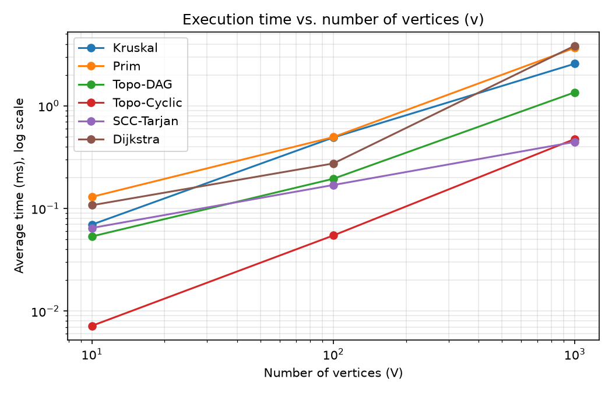
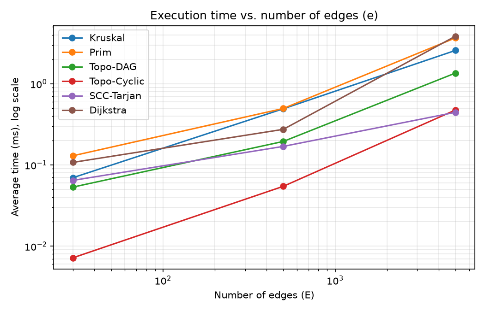

# Assignment 3 — Smart City Infrastructure and Route Planning

## 1. Overview

The program models a city as a graph and solves three planning tasks:

| Task                    | City meaning                                                                     | Algorithms                            |
|-------------------------|----------------------------------------------------------------------------------|---------------------------------------|
| Infrastructure planning | Cheapest set of roads that connects all districts                                | Kruskal (with DSU), Prim              |
| Connectivity analysis   | Build order of services; groups of districts that depend on each other in a loop | Topological sort (Kahn), SCC (Tarjan) |
| Route planning          | Shortest distance from one district to all others                                | Dijkstra                              |

**Graph representation**
- Vertices = districts, edges = roads or dependencies, weights = construction cost or distance.
- The graph is stored as an **adjacency list** (`Graph`), plus a flat list of edges (used by Kruskal for sorting).
- The same class works for directed and undirected graphs. An undirected edge is stored in both directions in the adjacency list.

**Demo:** `SmartCityDemo` shows all three tasks on 7 named districts (Downtown, Airport, University, Harbor, Old Town, Tech Park, Suburb).

**How to run** (from the project root)
```
javac -d out $(find src -name '*.java')
java -cp out Tests          # 27 correctness tests
java -cp out SmartCityDemo  # city demo
java -cp out Benchmark      # writes results/tables/*.csv
python3 plot.py             # writes results/plots/*.png (needs matplotlib)
```

## 2. Implementation

- **DSU.** Array-based. `find` uses path compression (iterative, so no deep recursion). `union` attaches the smaller tree to the larger one (union by size). Both optimizations can be switched off, so the benchmark can measure their effect.
- **Kruskal.** Sorts all edges by weight, then adds an edge only if `union` says its ends are in different components. Stops when V−1 edges are chosen. If fewer are chosen, the graph is not connected.
- **Prim.** Lazy version with `PriorityQueue`. It starts from a vertex and always takes the cheapest edge leaving the tree. Edges that lead to a vertex already in the tree are skipped when popped. For a disconnected graph it restarts from every unvisited vertex, so both algorithms return a minimum spanning *forest*.
- **Topological sort.** Kahn's algorithm (in-degrees + queue). If fewer than V vertices come out, the graph has a cycle.
- **SCC.** Tarjan's algorithm: one DFS with `disc[]`, `low[]` and a stack. A vertex with `low == disc` is the root of a component.
- **Dijkstra.** Binary heap with lazy deletion (push a new entry instead of decrease-key, skip stale ones). Returns distances and parents, so paths can be rebuilt. Unreachable vertices get distance `INF`. Throws an exception if any weight is negative.
- **Why Dijkstra fails with negative weights.** It declares a vertex final when it is popped from the heap, assuming no later path can be shorter. A negative edge breaks this. Example: `s→a (2)`, `s→b (5)`, `b→a (−4)`. Dijkstra finalizes `a` with 2, but the real shortest distance is 1.
- **Operation counters.** Each algorithm counts edge examinations, comparisons, and DSU/heap operations.

## 3. Complexity Analysis

Assumptions: adjacency list, binary heap (`PriorityQueue`), V vertices, E edges, α = inverse Ackermann function (below 5 for any practical size).

| Algorithm               | Time                                                                 | Space    | How V and E affect it                                                 |
|-------------------------|----------------------------------------------------------------------|----------|-----------------------------------------------------------------------|
| DSU `find` / `union`    | O(α(n)) amortized with both optimizations; O(n) worst case with none | O(n)     | Depends only on the number of elements, almost constant per operation |
| Kruskal                 | O(E log E) = O(E log V)                                              | O(V + E) | Sorting E edges dominates. DSU adds only O(E·α(V))                    |
| Prim                    | O(E log V)                                                           | O(V + E) | Every edge may enter the heap, each push/pop costs O(log V)           |
| Tarjan SCC              | O(V + E)                                                             | O(V)     | Every vertex and edge is visited once                                 |
| Topological sort (Kahn) | O(V + E)                                                             | O(V)     | Every vertex is queued once, every edge is examined once              |
| Dijkstra                | O((V + E) log V)                                                     | O(V + E) | Heap operations are about E, each costs O(log V)                      |

Notes:
- E log E = O(E log V) because E ≤ V², so log E ≤ 2 log V.
- On dense graphs (E ≈ V²) a simple array-based Prim would be O(V²), but we use the heap version.
- The recursive Tarjan needs O(V) stack depth. This is fine for V ≤ 1000.

**How DSU optimizations help**
- *Union by size* keeps trees shallow, so a tree with n nodes has height at most log n.
- *Path compression* makes every node on a searched path point directly at the root, so later searches are short.
- Together they give O(α(n)) amortized time per operation.

## 4. Experimental Setup

**Graph sizes**

| Graph  | V    | E    |
|--------|------|------|
| Small  | 10   | 30   |
| Medium | 100  | 500  |
| Large  | 1000 | 5000 |

**Graph generation** (fixed seed `42`, weights random in 1..100, no self-loops, no parallel edges)
- *Connected undirected graph (MST, Dijkstra):* first a random spanning tree (each new vertex connects to a random earlier vertex), then random extra edges until E is reached. This guarantees the graph is connected.
- *DAG (topological sort):* a random vertex order is chosen, and only edges going forward in that order are allowed. It has no cycles by construction.
- *Random directed graph (SCC, topological sort on cyclic input):* edges are random with no restriction. It contains cycles at all three sizes. Number of SCCs: Small 1, Medium 1, Large 18.
- Dijkstra runs on the undirected graph (every road works in both directions) from source vertex 0, so edge relaxations are about 2E.

**Measurement**
- Time is measured with `System.nanoTime()`.
- For each algorithm and size: 1 warm-up run (discarded, lets the JIT compile), then 5 timed runs, and the average is reported.
- Operation counts do not depend on the machine, so they are the same on every run.

## 5. Results

### 5.1 Time (average of 5 runs, ms)

| Algorithm                 | Small (V=10, E=30) | Medium (V=100, E=500) | Large (V=1000, E=5000) |
|---------------------------|--------------------|-----------------------|------------------------|
| Kruskal                   | 0.1066             | 0.6183                | 3.1684                 |
| Prim                      | 0.1478             | 0.4905                | 3.3325                 |
| Topological sort (DAG)    | 0.0585             | 0.2347                | 1.2745                 |
| Topological sort (cyclic) | 0.0097             | 0.0600                | 0.2942                 |
| SCC (Tarjan)              | 0.0458             | 0.1758                | 0.4136                 |
| Dijkstra                  | 0.1213             | 0.2542                | 3.1964                 |

### 5.2 Operation counts

| Algorithm                 | Counter               | Small | Medium | Large   |
|---------------------------|-----------------------|-------|--------|---------|
| Kruskal                   | edge examinations     | 14    | 164    | 3,356   |
| Kruskal                   | comparisons (sorting) | 107   | 3,827  | 50,369  |
| Kruskal                   | DSU `find` calls      | 28    | 328    | 6,712   |
| Prim                      | edge examinations     | 60    | 1,000  | 10,000  |
| Prim                      | comparisons (heap)    | 203   | 7,697  | 110,958 |
| Prim                      | heap operations       | 60    | 1,000  | 10,000  |
| Topological sort (DAG)    | edge examinations     | 60    | 1,000  | 10,000  |
| Topological sort (cyclic) | edge examinations     | 30    | 500    | 5,054   |
| SCC (Tarjan)              | edge examinations     | 30    | 500    | 5,000   |
| Dijkstra                  | edge relaxations      | 60    | 1,000  | 10,000  |
| Dijkstra                  | heap operations       | 36    | 400    | 3,974   |

**Both MST algorithms return the same total weight, since the required test is passed.**

### 5.3 DSU optimizations (n = 10,000, chain of unions, then `find` on every element)

| Configuration         | Pointer hops | Time (ms) |
|-----------------------|--------------|-----------|
| No optimization       | 49,995,000   | 112.832   |
| Path compression only | 19,997       | 0.608     |
| Union by size only    | 19,996       | 0.457     |
| Both                  | 19,996       | 0.713     |

### 5.4 Plots





*Both axes use a log scale.* 





## 6. Comparison and Discussion

**Kruskal vs Prim**
- Both have the same complexity, O(E log V), and always give the same total weight.
- Kruskal examines far fewer edges (3,356 vs 10,000 on the large graph) because it stops as soon as it has V−1 edges.
- Prim pushes every edge into the heap and pops stale edges later, so it does more heap work (110,958 vs 50,369 comparisons on the large graph).
- In my case, Prim was slightly faster than Kruskal.

**DSU.** Without optimizations, the chain test needs about 50 million pointer hops. With either optimization it needs about 20 thousand, which is 2,500 times fewer.

**SCC.** Edge examinations equal E exactly (30, 500, 5,000), so work grows linearly with the graph, as O(V + E) predicts. When V and E grow 10x, the count grows about 10x.

**Topological sort**
- On the DAG, every edge is examined (10,000 on the large graph).
- On the cyclic graph, the algorithm stops early because the cycle keeps in-degrees above zero (5,054 examinations). A cyclic input can therefore finish faster than a valid one.
- DAG time is visibly more than cyclic time. 

**Dijkstra.** Edge relaxations are 2E (each undirected road is used in both directions), so the work grows linearly with E. Heap operations are lower than E because many relaxations do not improve a distance. Dijkstra grows faster on larger sizes.

**Theory vs experiment**
- Operation counts match the theory: Kruskal's sort is about E log E, and SCC and topological sort are about V + E.
- Times on small graphs are very small (below 1 ms) and noisy because of JIT compilation and timer resolution, so only the Large graph gives reliable comparisons.

## 7. Testing

All tests are in `src/app/Tests.java` (27 checks, no external library). Run `java -cp out app.Tests`.

| Case                                    | What is checked                                                                                                             |
|-----------------------------------------|-----------------------------------------------------------------------------------------------------------------------------|
| Single vertex                           | MST weight 0, topological order valid, 1 SCC, Dijkstra distance 0                                                           |
| Small graph with known answer           | MST weight = 6 (computed by hand), MST has V−1 edges                                                                        |
| Disconnected graph                      | Both Kruskal and Prim report "not connected", forest weights are equal                                                      |
| Multiple valid MSTs / duplicate weights | 4-cycle with all weights equal gives the same total weight (15) in both algorithms                                          |
| Random graphs                           | 100 random connected graphs with many equal weights: Kruskal weight = Prim weight                                           |
| Topological sort, DAG                   | Simple chain, plus 100 random DAGs checked by an independent validator (every edge goes forward, every vertex appears once) |
| Topological sort, cycles                | 3-cycle, cycle not at the start, and dense random graphs are all detected as cyclic                                         |
| SCC                                     | Hand-made graph gives {0,1,2} and {3,4}; in a DAG every vertex is its own SCC                                               |
| SCC vs brute force                      | 100 random graphs compared with a reachability-based check, and every vertex is in exactly one SCC                          |
| Dijkstra                                | Correct distances and path, unreachable vertex handled, negative weight rejected                                            |
| Dijkstra vs reference                   | 100 random graphs compared with Bellman-Ford                                                                                |
| DSU                                     | Union returns false for the same set, `connected()` and component count are correct                                         |

**Result:** `27 passed, 0 failed`

## 8. Conclusion

- **MST:** Kruskal and Prim give the same cost. Kruskal is simpler and works well on sparse graphs and edge lists. Prim is natural when the graph is already an adjacency list or is dense.
- **DSU:** Path compression and union by size are cheap to write and make union-find almost constant time. They are worth always using.
- **Dependencies:** Kahn's algorithm gives a build order and detects cycles in O(V + E). When a cycle exists, Tarjan's SCC shows exactly which districts or services form it.
- **Routes:** Dijkstra is correct and fast for non-negative distances. For negative weights, Bellman-Ford should be used instead.
- **What I learned:** Understand difference between algorithms and implement them for applications.